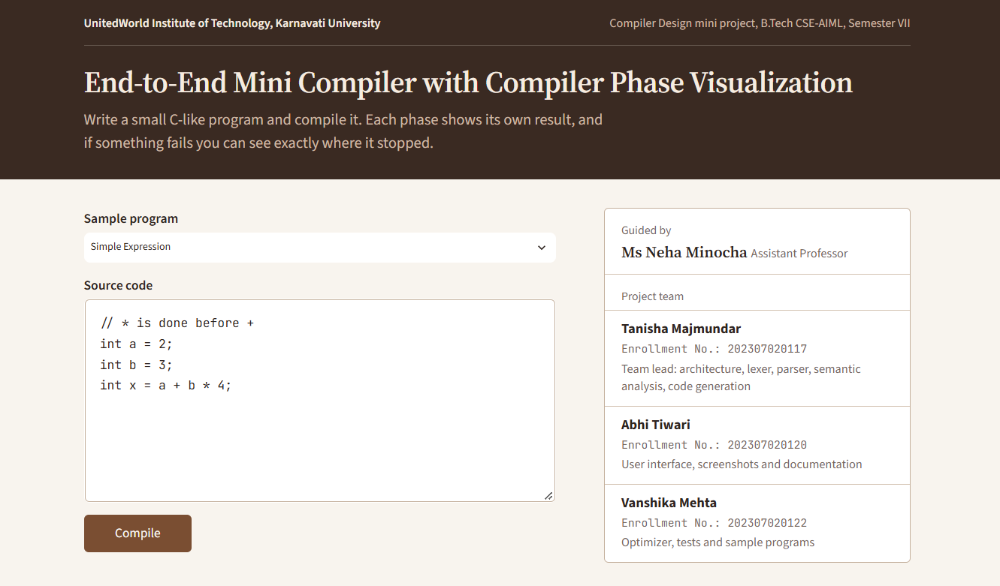
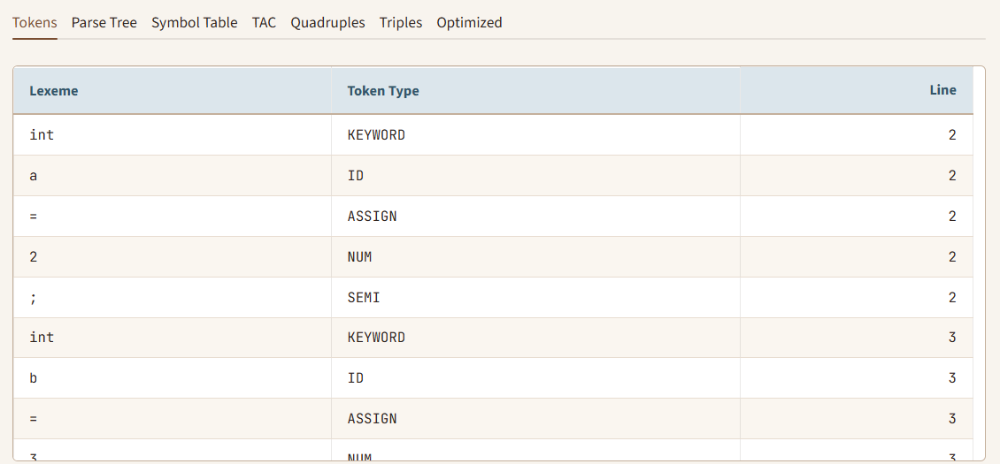
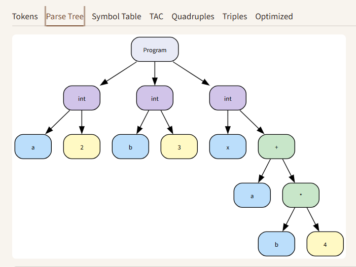
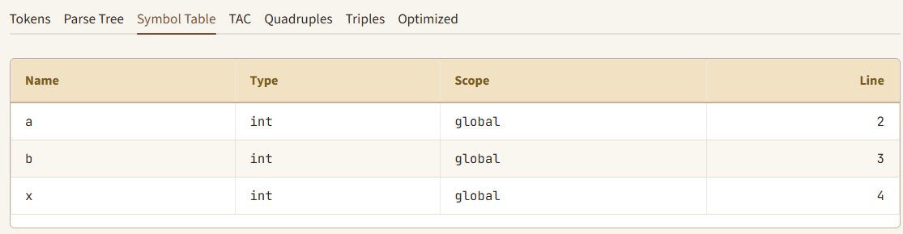
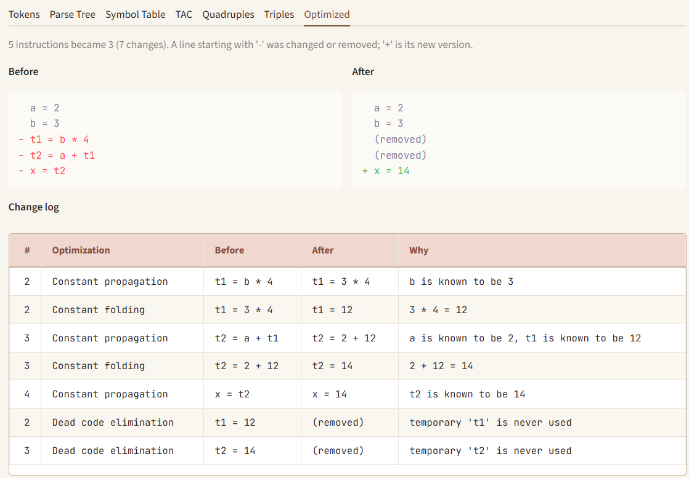
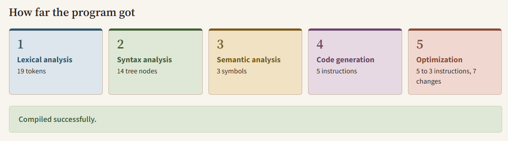
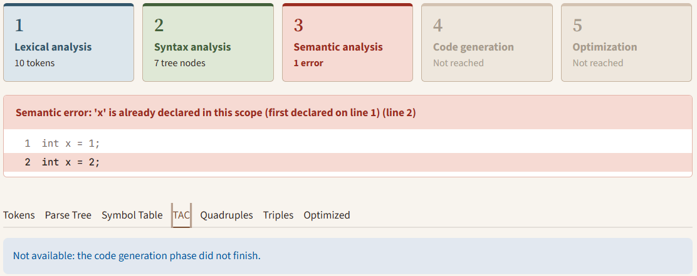

# End-to-End Mini Compiler with Compiler Phase Visualization

A hand-written compiler for a small C-like language, with a web interface that shows what every compiler phase produces. Type a program, press **Compile**, and see its tokens, parse tree, symbol table, Three Address Code, quadruples, triples and optimized code, each in its own tab. If a phase fails, the interface shows exactly where the program stopped.

**Live demo:** https://mini-compiler-visualizer-otvezg8am6edqyyrjagaml.streamlit.app/

Built for the Compiler Design course, B.Tech CSE-AIML, UnitedWorld Institute of Technology, Karnavati University.



---

## Why this project

Compiler phases are usually studied on paper. This project makes them visible: every phase is written by hand in plain Python (no Lex, Yacc, PLY or ANTLR), and every phase's output is shown on screen, so you can follow one program all the way from source text to optimized intermediate code.

## Features

- **Lexical analysis:** token table with lexeme, type and line number; invalid characters are reported with their line.
- **Recursive-descent parser:** builds a syntax tree, drawn with Graphviz, plus an indented text view. Syntax errors say what was expected and what was found.
- **Semantic analysis:** symbol table with name, type, scope and line; detects undeclared variables, duplicate declarations in the same scope, and float-to-int assignment (reported as a warning, which does not stop compilation).
- **Intermediate code:** Three Address Code with temporaries (`t1`, `t2`, ...) and labels (`L1`, `L2`, ...), shown also as quadruples and triples.
- **Optimizer:** constant folding, constant propagation and dead code elimination, with a before/after view and a change log explaining every change.
- **Phase status panel:** five colour-coded stage boxes show how far the program got (passed, failed, or not reached).
- **Clear errors:** each error shows its message, line number and the offending source line.
- **13 sample programs:** valid programs, optimization demos and programs with deliberate errors.

## Screenshots

| Tokens | Parse tree |
|---|---|
|  |  |

| Symbol table | Optimized code |
|---|---|
|  |  |

| Phase status after a successful compile | Error display |
|---|---|
|  |  |

## How it works

```
Source -> Lexer -> Parser -> Semantic Analyzer -> TAC Generator -> Optimizer
```

The compiler stops at the first phase that fails, but the outputs of all earlier phases are kept and shown.

### Example

Source:

```c
int a = 2;
int b = 3;
int x = a + b * 4;
```

Three Address Code:

```
a = 2
b = 3
t1 = b * 4
t2 = a + t1
x = t2
```

After optimization (propagation, folding, dead code elimination):

```
a = 2
b = 3
x = 14
```

Quadruples `(op, arg1, arg2, result)` for the same program:

| # | op | arg1 | arg2 | result |
|---|---|---|---|---|
| 0 | = | 2 | | a |
| 1 | = | 3 | | b |
| 2 | * | b | 4 | t1 |
| 3 | + | a | t1 | t2 |
| 4 | = | t2 | | x |

Triples refer to earlier results by index, for example `(+, a, (2))`.

### Error messages

```
Lexical error: invalid character '$' (line 1)
Syntax error: expected ')' but found ';' (line 4)
Semantic error: 'y' used before declaration (line 3)
```

## The language

Types `int` and `float`; declarations with an optional initializer; assignment; `if` / `if-else`; `while`; blocks `{ }`; `+ - * /`; parentheses; relational operators `< > <= >= == !=`; `//` comments.

```
Program -> StmtList
Stmt    -> Decl | Assign | If | While | Block
Decl    -> (int | float) id [ = Expr ] ;
Assign  -> id = Expr ;
If      -> if ( Cond ) Block [ else Block ]
While   -> while ( Cond ) Block
Block   -> { StmtList }
Cond    -> Expr relop Expr
Expr    -> Expr + Term | Expr - Term | Term
Term    -> Term * Factor | Term / Factor | Factor
Factor  -> ( Expr ) | id | num
```

Left recursion in `Expr` and `Term` is removed with loops in the parser, which keeps `+ - * /` left-associative (`8 - 3 - 2` is `(8 - 3) - 2`) and gives `*` and `/` higher precedence than `+` and `-`.

## Project structure

```
app.py                  Streamlit interface
compiler/
  errors.py             shared error type and message format
  lexer.py              tokenize(source) -> tokens
  parser.py             recursive-descent parser, Node class
  semantic.py           symbol table and semantic checks
  codegen.py            TAC, quadruples, triples
  optimizer.py          folding, propagation, dead code elimination
  visualize.py          tree to Graphviz DOT and text
  pipeline.py           compile_source(): runs all phases
examples/               13 sample programs
tests/                  pytest tests for every module
.streamlit/config.toml  light theme
```

The `compiler/` package never imports Streamlit, so it can be tested and run without the interface.

## Getting started

Requires Python 3.10 or newer.

```bash
git clone https://github.com/TanishaMajmundar/mini-compiler-visualizer.git
cd mini-compiler-visualizer
pip install -r requirements.txt
streamlit run app.py
```

The app opens at http://localhost:8501. Run the tests with:

```bash
pytest
```

## Deployment

The app is deployed on Streamlit Community Cloud straight from this repository (main file `app.py`, Python 3.11). Pushing to `main` updates the live app.

## Design decisions and limitations

- **No parser generators.** The lexer and parser are written by hand, as the course intends.
- **The syntax analyzer stops at the first syntax error.** The lexer reports every invalid character, and the semantic analyzer reports every semantic problem, but the parser does not try to recover.
- **A missing `;` is reported on the previous line,** because that is where the mistake actually is.
- **The optimizer is conservative.** Known constants are forgotten at every label and jump (loops and `if/else` can reach a label from elsewhere). Variables you declared are never removed, because the language has no print statement and their final values count as the program's result. Integer division is folded only when it divides exactly, and division by zero is never folded.
- **In triples, jumps keep the label name** (`L1`) as their target instead of an instruction index.
- **Language limits:** only `int` and `float`; one relational operator per condition (no `&&` or `||`); `if` and `while` bodies must be blocks; no `else if` chains, unary minus, functions, arrays, strings or input/output.
- The compiler produces intermediate code, not machine code.

## Possible extensions

Common sub-expression elimination, basic blocks with a control-flow graph, a TAC interpreter that prints final variable values, more operators and error recovery.

## Team

| Name | Enrollment No. | Contribution |
|---|---|---|
| Tanisha Majmundar | 202307020117 | Team lead: architecture, lexer, parser, semantic analysis, code generation |
| Abhi Tiwari | 202307020120 | User interface, screenshots and documentation |
| Vanshika Mehta | 202307020122 | Optimizer, tests and sample programs |

**Guide:** Ms Neha Minocha, Assistant Professor, Department of Computer Science & Engineering Technology, Karnavati University, Gandhinagar.

## License

MIT, see [LICENSE](LICENSE).
